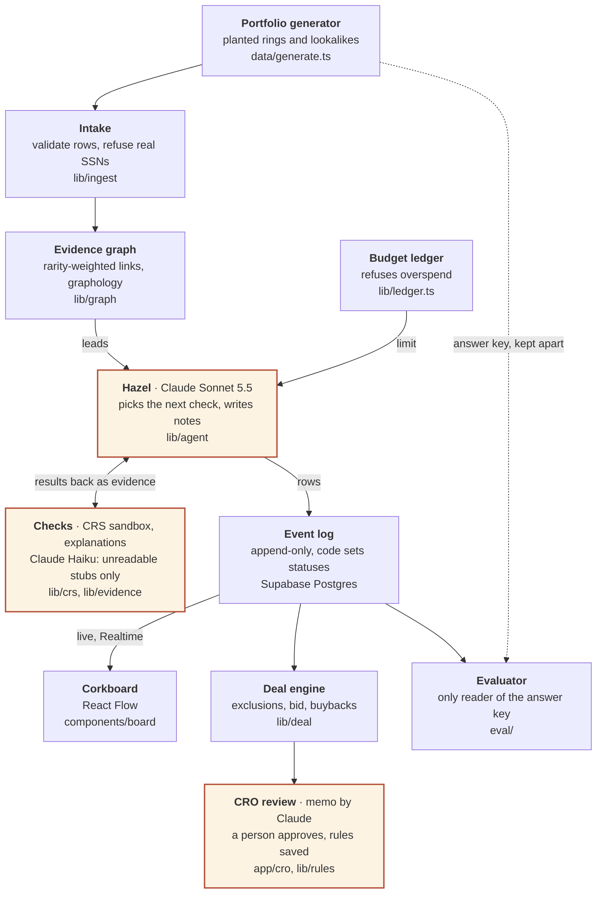

# Threadpull

**Find the ring. Protect the innocent. Decide the deal.**

An AI fraud investigator for banks buying auto-loan portfolios. Upload the loan tape: we tell you which borrowers don't exist, which ones only look suspicious, and how much less to pay. Hazel, the investigator agent, follows evidence across 1,000 loans on a limited verification budget, takes suspicion back down when a check proves an innocent explanation, and hands the Chief Risk Officer a decision that a person approves.

Built at Cal Hacks 13.0 for the seat of a **fraud investigator on a bank's portfolio-acquisition due-diligence team**.

## Try it

| | Link |
| --- | --- |
| Live site | https://threadpull.vercel.app |
| Held-out run on the board (recorded) | [/board?run=r99-20261025T102031](https://threadpull.vercel.app/board?run=r99-20261025T102031) |
| Its CRO screen, with the accuracy table | [/cro?run=r99-20261025T102031](https://threadpull.vercel.app/cro?run=r99-20261025T102031) |
| Ask once, remember forever (rule R-001 at work) | [/board?run=r13-20261025T091630](https://threadpull.vercel.app/board?run=r13-20261025T091630) |
| Measured results | [docs/PROOF.md](docs/PROOF.md) · [landing page](https://threadpull.vercel.app/#results) |

On [/upload](https://threadpull.vercel.app/upload) anyone can use our 1,000-loan sample, **generate a fresh portfolio from any seed** (250 to 2,000 loans) or upload their own JSON/CSV tape. Investigating it runs Hazel live on Claude and the CRS sandbox with a 30, 60 or 120-acorn budget, so it asks for the team's passcode.

## Results

Generated by `bun run eval` from recorded runs, on detection code frozen with a git tag (`detector-frozen`) **before** the held-out portfolio was run. Seed 99 was written by a teammate who wrote no detection code, run once, and reported as it came out.

| Seed 99 (held out) | Ring members found | Innocents flagged | Review cases right | Acorns |
| --- | --- | --- | --- | --- |
| **Threadpull (Hazel)** | **12 of 12** | **0 of 65** | 1 of 3 | 59 |
| Fixed rules, same budget | 12 of 12 | 8 of 65 | 1 of 3 | 60 |
| Check everything, no budget | 3 of 12 | 0 of 65 | 3 of 3 | 233 |

Hazel had every ring member marked Investigate after 17 acorns; the rest of the budget went on spot checks of the largest unverified balances. On the development seed 13: 6 of 6 ring members, 0 of 50 innocents flagged, ring complete after 14 acorns. Run ids, commits, definitions and what the numbers don't show are in [docs/PROOF.md](docs/PROOF.md).

## How it works

- **Find the ring.** An evidence graph links loans that share a phone, bank account, device, IP, employer, dealer or document template, weighted by how rare the shared value is. Location alone is never a signal.
- **Spend a limited budget.** Paid checks on the CRS sandbox (TransUnion identity, three-bureau credit report, AtData Fraud Finder, AccurateAppend reverse phone) cost acorns. A ledger in code reserves each price and refuses what would overspend.
- **Protect the innocent.** A thread comes down only when a check proves an ordinary explanation (a 212-unit apartment building, one household, a dealer's month-end push) and cites it.
- **Ask once, remember forever.** When Hazel can't decide, the right person gets one question with a confidence and reason computed by code. A yes becomes a versioned rule that later runs apply on their own; a case outside its scope asks again.
- **Ignore instructions in documents.** A pay stub telling the reviewer to clear the loan is logged as `attack_detected`, never reaches the model, and changes nothing.
- **Decide the deal.** The CRO screen shows what to exclude, reprice or protect, drafted buyback demands and a revised bid. A person approves; Hazel can't buy, reject, sign or send anything.

## Architecture

Claude plans the checks; code holds the evidence and the math. A model runs in three places (highlighted): Hazel choosing the next check, reading a pay stub the parser can't, and drafting the CRO memo. The graph, the budget, every status and every number are plain, tested code.



**Stack:** TypeScript, Bun, Next.js 16, React 19, React Flow, Tailwind, Motion, graphology, Zod, Faker, Supabase (Postgres + Realtime), Anthropic TypeScript SDK, CRS sandbox API, Vercel.

### Where Claude is used

| Where | Model | What it does | What code does instead |
| --- | --- | --- | --- |
| Hazel (`lib/agent/hazel.ts`) | Claude Sonnet 5.5, SDK tool runner | Chooses the next check and writes short notes citing their sources | Validates every tool input, charges the budget, writes each event row, applies rules, decides every status (`lib/agent/status.ts`) |
| Pay stubs (`lib/evidence/extract.ts`) | Claude Haiku 4.5 | Reads a stub the fixed parser can't | Accepts a value only if it's printed on the line Haiku cites; lines with instructions never reach the model |
| CRO memo (`lib/deal/memo.ts`) | Claude Sonnet 5.5 | Drafts the memo from the report | Keeps only sentences it can check against the run's events |

When Hazel has no lead left and budget remains, code (not Claude) runs a **verification sweep**: an identity check, then a credit report, on the largest unverified balances.

### Where CRS is used

All calls go to the CRS **sandbox**. A persona guard (`lib/crs`) builds request bodies only from the 20 sandbox personas in `data/personas.json`, so a loan without one is refused before anything is sent. Every result keeps its CRS RequestID. Real sandbox responses recorded on 2026-10-24 are in `data/crs-recordings/` and back the tests and `bun run hazel --crs recorded`.

## Run it locally

Install [Bun](https://bun.sh/), then:

```sh
bun install
cp .env.example .env.local   # fill in the keys you have; names only, never commit values
bun run data --no-db         # seed 13: data/out/seed13/ (tape) and data/keys/seed13/ (answer key), both gitignored
bun test                     # unit and architecture tests
bun run dev                  # http://localhost:3000
```

| Command | What it does |
| --- | --- |
| `bun run data [--spec data/patterns/seed99.json] [--no-db]` | Generate a portfolio; without `--no-db` also loads Supabase |
| `bun run hazel [--crs recorded] [--budget 60] [--lead L0101] [--no-rules]` | Run Hazel once and score her against the answer key. Needs `ANTHROPIC_API_KEY`; live CRS also needs `CRS_USERNAME` and `CRS_PASSWORD` |
| `bun run eval --run <run_id> [--write]` | Score a recorded run against the answer key and the two baselines; `--write` updates `docs/PROOF.md` (frozen detection code only) |
| `bun run freeze:check` | Whether detection code still matches the `detector-frozen` tag (held-out runs are refused otherwise) |
| `bun run data:check --spec <spec>` | Validate a pattern spec without printing the truth |
| `bun run haiku:trial` | Measure the Haiku stub reader on 102 stubs |
| `bun run typecheck` | TypeScript, no emit |

In the app: `/upload` → **Investigate** → the board at `/board?run=<run_id>` → the CRO screen at `/cro?run=<run_id>`, where questions are answered and actions approved or overridden. Questions and rulings are kept in `runs/rules.json`; `--no-rules` starts a clean run, as the proof runs were.

### Public demo (Vercel)

The deployed site (`PUBLIC_DEMO=1`) shows the recorded runs in [demo/](demo/README.md) and plays runs from Supabase. A live investigation needs the team's passcode (`INVESTIGATE_PASSCODE`) and keeps its function alive until it ends (up to 5 minutes). Answers, decisions and memos are local-app only. Environment variables: `NEXT_PUBLIC_SUPABASE_URL`, `NEXT_PUBLIC_SUPABASE_ANON_KEY` (public); `ANTHROPIC_API_KEY`, `CRS_USERNAME`, `CRS_PASSWORD`, `SUPABASE_URL`, `SUPABASE_SERVICE_ROLE_KEY`, `INVESTIGATE_PASSCODE` (secrets). See `.env.example`.

## Real versus simulated

- **Real:** CRS sandbox calls (with RequestIDs), Claude calls, the event log in Supabase, and every number in `docs/PROOF.md`.
- **Synthetic:** all loans (seeded generator) and identities (CRS sandbox personas). No real people's data anywhere.
- **Simulated, and labelled so wherever shown:** the address and employer reference lookups (unit counts, employer headcounts).
- **Tested with a stand-in:** Hazel's loop is unit-tested with a scripted stand-in for Claude; live runs use the real model.

## Known limits

- **Uploaded tapes carry no unit counts or employer headcounts.** A lookalike that needs one to be cleared may stay up, so an uploaded run isn't directly comparable with the proof runs on innocents flagged.
- **Accuracy is scored only for the proof runs.** The app never reads answer keys, so a run on an uploaded or seed tape has no score.
- **Only the 60-acorn budget has been measured;** 30 and 120 are offered but not measured. Review cases are reached 1 of 3 on both seeds.
- **No sign-in.** The name on a decision or answer is whatever is typed into "Deciding as", and anyone who can open the local app can write a memo (which spends the API key).
- **Rules live in `runs/rules.json`** on the machine that runs Hazel; the Supabase `rules`/`questions` tables aren't built.
- **The memo check** drops sentences it can't tie to an event, but doesn't prove the cited event supports the sentence.
- **Text documents only:** no PDF or image OCR. Generated portfolios have no stubs the parser can't read, so the demo and proof runs never call Haiku.
- **No replay speed control or one-command demo** yet (ticket 15).

## Responsible design

A connection is a lead, not proof. Threadpull's output is a recommendation for human review, never an adverse action on a consumer. Location-only signals are never used (fair-lending risk). Production use would need a permissible purpose under the FCRA, approved data access and legal review.

## Repository map

| Path | What's there |
| --- | --- |
| `app/` | Next.js pages (landing, upload, board, CRO, dashboard) and API routes |
| `components/` | UI: corkboard, CRO screen, filing drawer, upload desk, landing |
| `lib/` | `agent` (Hazel), `graph`, `evidence`, `crs`, `ledger.ts`, `rules`, `deal`, `ingest`, `events`, `contracts` |
| `data/` | Generator, pattern specs, CRS personas and recordings ([data/README.md](data/README.md)) |
| `eval/` | Evaluator and baselines: the only code that reads answer keys |
| `docs/` | [PROOF.md](docs/PROOF.md), [ARCHITECTURE.md](docs/ARCHITECTURE.md), [SKELETON.md](docs/SKELETON.md) (contracts), [DESIGN.md](docs/DESIGN.md) |
| `supabase/migrations/` | `loans`, `events`, `crs_cache`, `dispositions` |
| `tests/` | 868 tests, including architecture rules (e.g. only `eval/` may read answer keys) |

Never commit `.env.local`, keys or generated data.
