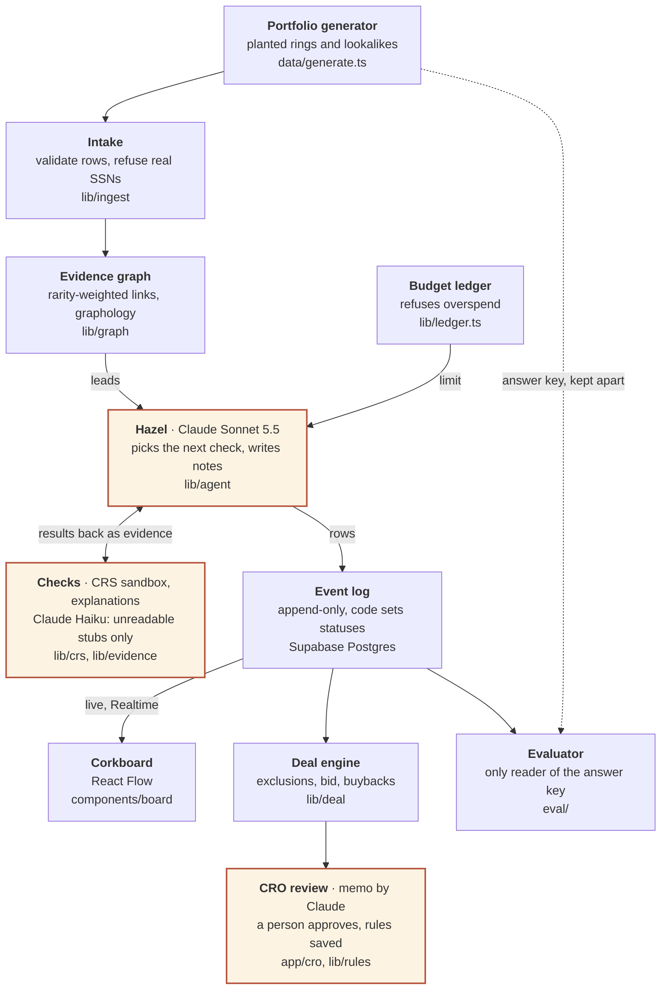

# Threadpull

**Find the ring. Protect the innocent. Decide the deal.**

Upload the loan tape. We tell you which borrowers don't exist, which ones only look suspicious, and how much less to pay. Hazel, an investigator agent, follows evidence across auto loans, uses a limited verification budget, and prepares a review for the Chief Risk Officer.

**Seat:** Fraud investigator on a bank's portfolio-acquisition due-diligence team.

**Live demo:** https://threadpull.vercel.app · board of the held-out run: [/board?run=r99-20261025T102031](https://threadpull.vercel.app/board?run=r99-20261025T102031) · its CRO screen: [/cro?run=r99-20261025T102031](https://threadpull.vercel.app/cro?run=r99-20261025T102031). Measured results are on the landing page (`/#results`) and on each proof run's CRO screen. On `/upload` anyone can use our 1,000-loan sample, generate a new portfolio from any seed (250 to 2,000 loans) or upload their own; investigating it live needs the team's passcode (it spends Claude and CRS calls), with a 30, 60 or 120-acorn budget.

**Results on frozen detection code** ([docs/PROOF.md](docs/PROOF.md), generated by `bun run eval` from recorded runs): on the held-out seed 99, written by a teammate who wrote no detection code and run once, Hazel found **12 of 12** ring members and flagged **0 of 65** innocent lookalikes for 59 of 60 acorns. A fixed rules engine on the same budget also found 12 of 12 but flagged 8 innocents; checking every loan with every CRS product cost 233 acorns and found 3 of 12. On the development seed 13: 6 of 6, 0 of 50.

Threadpull is a prototype. The TypeScript code includes a deterministic portfolio generator and normalizer, the evidence graph (`lib/graph`), explanation and document checks (`lib/evidence`), the CRS client with persona guard and acorn ledger (`lib/crs`, `lib/ledger.ts`), ask-once rules (`lib/rules`), and Hazel's tool loop (`lib/agent`), plus the Next.js app (landing, upload, the investigator board, the CRO screen, the dashboard) and its API routes. The earlier Python prototypes in `backend/` are kept for reference only. The full status is in [docs/ARCHITECTURE.md](docs/ARCHITECTURE.md), with product/data contracts in [docs/SKELETON.md](docs/SKELETON.md).

## Architecture

Claude plans the checks; code holds the evidence and the math. A model runs in three places (marked **Claude**): Hazel choosing the next check, reading a pay stub the parser can't, and drafting the CRO memo. The graph, the budget, every status and every number are plain, tested code.



## Setup and data

Install [Bun](https://bun.sh/) and run:

```sh
bun install
cp .env.example .env.local
bun run data --no-db
bun test
```

`bun run data --no-db` creates the seed 13 files under `data/out/seed13/` and the separate answer key under `data/keys/seed13/`. Those generated directories are gitignored. To seed Supabase instead, fill in the server-only values in `.env.local` and run `bun run data`. See [data/README.md](data/README.md) for the loan shape, patterns, and output files.

`bun run dev` starts the app: the board at `/board?run=<run_id>`, the CRO screen at `/cro`. `bun run hazel` runs an investigation (needs `ANTHROPIC_API_KEY` and CRS credentials, or `--crs recorded`). A one-command demo with replay speed control is still open (ticket 15).

## Claude and CRS

Hazel runs on Claude Sonnet 5.5 (`claude-sonnet-5-5`) through the Anthropic TypeScript SDK's tool runner (`lib/agent/hazel.ts`), with server-side refusal fallback enabled. Claude chooses the next tool and writes short notes. Code does everything else: it opens the lead, validates every tool input, charges the acorn budget, writes each event row, takes threads down only when a check proves an innocent explanation, applies saved rules, and decides every status (`lib/agent/status.ts`). When Hazel has no lead left and budget remains, code runs a verification sweep: it spends the rest checking the largest unverified balances (an identity check, then a credit report when the identity checks out), so a fraud alert, a frozen bureau or bureaus that disagree on a loan tied to nothing else can still surface. Claude never sees raw document text, only form fields, and injected instructions are flagged as `attack_detected`.

CRS: `crs_identity_check` calls TransUnion identity verification on the CRS sandbox (`lib/crs`). The persona guard builds request bodies only from `data/personas.json`, so a loan without a sandbox persona is refused before anything is sent. Every result keeps the CRS RequestID. Real sandbox responses recorded on 2026-10-24 are in `data/crs-recordings/` and back the tests and `bun run hazel --crs recorded`. Hazel also has the tri-bureau credit report (thick file, thin life features; frozen and disagreeing bureaus mean Insufficient evidence), AtData Fraud Finder and AccurateAppend reverse phone, each charged in acorns and logged with its RequestIDs. Any simulated lookup data is identified as simulated in [data/README.md](data/README.md).

## From a loan tape to a decision, in the app

1. `bun run dev`, then open `/upload`. Drop a JSON or CSV loan tape, or use one from the page: the 1,000-loan seed 13 sample, a portfolio generated from any seed and size (`GET /api/sample-tape?seed=&loans=`, the development spec's planted cases with the visitor's seed; `data/sample-tape.ts`, which returns the tape without the answer key), or the 3-loan CSV template. Intake validates every row, refuses any SSN that could belong to a real person, flags documents with instruction-like text, and shows the report.
2. Choose the verification budget (30, 60 or 120 acorns; every measured result used 60). **Investigate these N loans** starts Hazel on the accepted loans on the server (live CRS sandbox and Claude; needs `ANTHROPIC_API_KEY`, `CRS_USERNAME`, `CRS_PASSWORD`), one run at a time. The board follows the run live at `/board?run=<run_id>`; the filing drawer and Twin Compare read the tape's loans.
3. `/cro?run=<run_id>`: the deal, the questions for a person, and Approve / Override on each proposed action.

An uploaded tape has no address or employer reference data, so `check_address` and `check_employer` answer "unknown" rather than guess, and no thread comes down on them; a generated seed run with `bun run hazel` has both. This applies to the sample and the seed tapes on the upload page too: their reference holds only what the street text says (a unit or suite number), with no unit counts or employer headcounts, so a lookalike that needs one of those to be cleared may stay up, and an uploaded run is not directly comparable with the proof runs on innocents flagged.

## Public demo (Vercel)

The deployed site (`PUBLIC_DEMO=1`) shows the recorded runs in [demo/runs](demo/README.md) to everyone (`THREADPULL_RUNS=demo/runs`), and the board plays runs from Supabase. A live investigation of an uploaded tape spends Claude tokens and CRS calls, so it asks for the team's passcode (`INVESTIGATE_PASSCODE`). The tape is sent again with the request, and the run keeps its function alive until it ends (`after()`, up to 5 minutes). There is no shared disk on a serverless host, so a new run's files and the tape sit in that server instance's `/tmp`: the board (Supabase) always shows the run; the CRO screen and the filing drawer show it when they reach the same instance. Answers, decisions and memos stay in the local app. The build generates seeds 13 and 99 (`vercel.json`). Keys on Vercel: `NEXT_PUBLIC_SUPABASE_URL` and `NEXT_PUBLIC_SUPABASE_ANON_KEY` (public); `ANTHROPIC_API_KEY`, `CRS_USERNAME`, `CRS_PASSWORD`, `SUPABASE_URL`, `SUPABASE_SERVICE_ROLE_KEY` and `INVESTIGATE_PASSCODE` as production secrets.

## Ask once, remember forever

When Hazel can't decide and nobody has ruled on a case like it, she asks one person once (`ask_human`). Code routes the question (CRO, credit analyst, legal, compliance), computes the confidence and the reason from the evidence, and proposes the scope a yes would save, using only facts the run can check. The person answers on the CRO screen (`/cro?run=<run_id>`, "Questions for you"): a yes becomes a versioned rule, a no saves nothing, and either way a `question_answered` row is added to the run's log and the board. Later runs apply the rule on their own and cite it when a thread comes down; a link outside the rule's scope stays up.

```sh
bun run hazel                  # questions and rulings are kept in runs/rules.json (run.json lists the rules in force)
# answer on /cro?run=<run_id>, then:
bun run hazel --lead L0742     # --lead: the operator picks the first leads (recorded as such)
bun run hazel --no-rules       # a clean run that remembers nothing, as the proof runs were
```

Runs started from the upload page use the same `runs/rules.json`. A fresh clone has no rulings, so `bun run hazel` there starts as clean as `--no-rules`.

## Real versus simulated

The generator, normalizer, contracts, graph/agent/rule prototypes, and proof helpers are local code. Portfolio contents are synthetic. The address/employer reference lookups generated for the demo are simulated; they are not live external verification. Hazel's loop is tested with a scripted stand-in for Claude; live runs are written to the Supabase `events` table and shown on the board at `/board?run=<run_id>`. Measured results come only from recorded runs and the evaluator (`bun run eval`), on the `detector-frozen` tag: see [docs/PROOF.md](docs/PROOF.md), which also lists what they don't show (one run per agent; review cases reached 1 of 3).

## Known limits

- No `bun run demo` or replay with speed control yet (ticket 15); the board plays a recorded run from Supabase.
- The CRO screen (`/cro`, tickets 10 and 14) reads a run from the `runs/<run_id>/` folder of the machine that serves it, and from the Supabase `events` table when that folder doesn't have it; it needs the run's loans (`bun run data --no-db` for a seed, or the uploaded tape). Prices on it are labeled assumed. A decision is saved in the run's event log and copied to the Supabase `dispositions` table once its migration is applied.
- The CRO memo is written by the model and kept as `runs/<run_id>/memo.json`. Code drops any sentence it cannot check against the run's events, but it does not check that a cited event supports the sentence.
- There is no sign-in. The name on a decision is whatever is typed into "Deciding as", so it is not proof of who decided, and anyone who can open the page can write a memo, which spends the model API key. Run it only on a trusted machine.
- `/dashboard` shows status counts and run metrics only. Accuracy against an answer key is shown only for the two proof runs (landing page and their CRO screens): the app never reads answer keys, so a run on an uploaded or seed tape has no score.
- The budget choice on the upload page offers 30, 60 and 120 acorns; only 60 has been measured.
- Questions and rulings are kept in `runs/rules.json` on the machine that runs Hazel and serves the CRO screen; the Supabase `rules`/`questions` tables are not built (ticket 11). Like decisions, the name on an answer is whatever is typed into "Deciding as".
- Pay stubs in the generated layout are read by a fixed-label parser. A stub it can't read (another payroll system, a table, a scan) is read by Claude Haiku in live runs (`bun run hazel`), and code accepts it only if every value is printed on the line Haiku cites; otherwise the stub is reported unreadable. `bun run haiku:trial` measures this on 102 stubs; the generated portfolios contain no such stubs, so the demo and proof runs never call it. Text only: no PDF or image OCR.
- Address and employer lookups are simulated stand-ins and are labeled simulated wherever they appear.
- The Python modules in `backend/` predate the TypeScript architecture and are not used by it.
- This is not a credit decision system. It is designed for synthetic data and human review; production use would require approved data access, legal review, and validation.

## Team

| Role | Responsibility |
| --- | --- |
| A — Evidence | Portfolio data, documents, fingerprints, and explanations |
| B — Verification | CRS checks, verification tools, recovery, and deal engine |
| C — Board | Contracts, investigator UI, replay, and held-out set |
| D — Investigation | Evidence graph, Hazel loop, rules, baseline, proof, and submission |

## Development

Run the TypeScript unit and architecture tests with `bun test`.

Run Hazel once on seed 13 and measure her against the answer key with `bun run hazel --crs recorded` (CRS answers replayed from the recordings) or `bun run hazel` (live CRS sandbox). It needs `ANTHROPIC_API_KEY` in `.env.local` (and the CRS logins for a live run), costs real API usage, and writes `runs/<run_id>/` (gitignored). The older Python prototype dependencies are in [requirements.txt](requirements.txt); its unit tests can be run with `python -m unittest discover -s tests` in an environment with those dependencies installed.

Do not commit `.env.local`, API keys, or generated data. Use `.env.example` as the variable-name reference and keep real values server-side.
