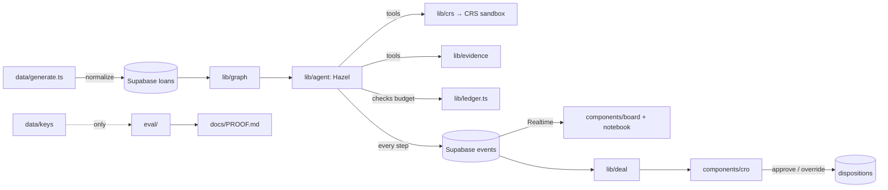

# Threadpull: architecture and project structure

The one place that says **where code goes**. If you're about to create a folder that isn't listed here, add it to this file in the same commit (and tell the team).

## 1. Top level

```
Threadpull/
├── README.md          what it is, how to run it
├── CLAUDE.md          rules for coding agents (stays at the root so Claude Code finds it)
├── docs/              everything humans read: spec, brief, this map, tickets, team plans, research
├── app/               Next.js routes: pages and app/api/* route handlers (thin)
├── components/        React UI only
├── lib/               all logic: contracts, CRS, graph, agent, evidence, deal (no React)
├── data/              generator, persona fixtures, pattern specs (outputs gitignored)
├── public/            static files served as-is: hazel/ (Hazel's poses), assets/detective/ (cork, walnut, paper textures), templates/ (loan-tape CSV template, A)  C
├── eval/              baseline agent and evaluator: the ONLY code that reads answer keys
├── supabase/          SQL migrations (tables, RLS)
└── tests/             bun tests, one file per module
```

Config files at the root: `package.json`, `bun.lock`, `tsconfig.json`, `.gitignore`, `.env.example` (never `.env*` with values).

## 2. Full map, with owners

✅ = exists now · ○ = planned (create it when your ticket needs it)

```
docs/
  SKELETON.md            ✅ contracts + 24-hour plan (wins on conflict)            all
  TEAM_BRIEF.md          ✅ the why: problem, demo, data, metrics                    all
  ARCHITECTURE.md        ✅ this file                                                all
  tickets/01..16-*.md    ✅ one file per ticket                                      all
  team/person-*.md       ✅ one plan per person                                      all
  research/              ✅ competitor scans, Hyphenate notes                        all
  PROOF.md               ✅ status note (no measured claims yet); generated results ○ (ticket 13)   D

app/                                                                                 C
  page.tsx               ✅ investigator view: filing drawer + corkboard + evidence panel + notebook (`/?run=<id>` plays a Supabase run)
  dashboard/page.tsx     ✅ Portfolio Intelligence: status counts and run metrics from recorded rows, Hazel's Case Notes
  cro/page.tsx           ✅ CRO screen: reads a run with `?run=<id>`, shows the report, takes approve/override   B
  landing/page.tsx       ✅ landing page: hero corkboard, promises, how it works, limits      A
  upload/page.tsx        ✅ upload a loan tape: intake envelope + intake report           A
  api/loans/route.ts     ✅ GET /api/loans                                            A
  api/tapes/route.ts     ✅ POST /api/tapes: upload a loan tape (JSON or CSV), intake report  A
  api/runs/route.ts      ✅ GET /api/runs: the runs on disk, newest first             B
  api/runs/[id]/report/  ✅ GET /api/runs/[id]/report: report + drafts under the analyst's assumptions  B
  api/runs/[id]/memo/    ✅ GET/POST /api/runs/[id]/memo: Claude writes the CRO memo, code keeps the sentences it can check   B
  api/runs/[id]/why/…    ✅ GET /api/runs/[id]/why/[loan_id]: a loan's verdict explained from the run's events only   B
  api/runs/…             ○ POST /api/runs (D)
  api/questions/…        ○ POST /api/questions/[id]/answer                           D
  api/dispositions/…     ✅ POST /api/dispositions: record an approve or override       B

  dev/drawer/page.tsx     development-only filing drawer preview (404 in production) C

components/
  ui/                    ○ shadcn/ui primitives (generated by `bunx shadcn add`)     C
  board/                 ✅ corkboard (React Flow + Motion), index cards, yarn, evidence panel, camera   C
  drawer/                ✅ filing drawer, status chips, filters                       C
  notebook/              ✅ Hazel's notebook, acorn meter                              C
  dashboard/             ✅ Portfolio Intelligence page and its data hook               C
  twin-compare/          ✅ Twin Compare panel (in the evidence panel)                 A
  landing/               ✅ hero case board, shared site header and footer               A
  upload/                ✅ upload desk, intake report view, upload model                A
  cro/                   ✅ CRO screen: totals, verdict table, drafts, decisions, memo, why (neutral Tailwind, not the cork look)  B

lib/
  contracts/             ✅ Zod schemas + types: loan ✅, tool-result ✅, graph ✅, event (C's draft, used unchanged), rule ✅   C (loan, tool-result: A; graph, rule: D)
  ingest/                ✅ normalize the messy tape; reference lookups; tape intake (CSV/JSON upload, row checks, synthetic-SSN guard)  A
  db/                    ✅ Supabase clients: server.ts (service role, D), browser.ts (anon, C)
  crs/                   ✅ persona guard, client + cache, identity check, credit report, Fraud Finder, reverse phone   B
  ledger.ts              ✅ acorn budget; its onSpend hook is where `budget_spent` is written   B
  event-rows.ts          ✅ budget_spent and recovery event rows from the ledger and the CRS client (pure; C may fold into events/)   B
  graph/                 ✅ graphology evidence graph, weights, clusters, priority      D
  evidence/              ✅ document fingerprints, injection guard, explanation checks, withdraw  A
  agent/                 ✅ Hazel loop (Anthropic SDK tool runner), tools, prompts, models.ts  D
  rules/                 ✅ ask-once questions, rule matching and versions; in-memory store (Supabase ○)  D
  deal/                  ✅ verdicts, pricing, report, buyback + document-request drafts, dispositions (file log + Supabase copy), CRO memo (Claude), why answers, wording rules  B
  events/                ✅ board state reducer, Supabase Realtime feed, preview fixture, Hazel's pose/notebook   C
  dashboard/             ✅ dashboard metrics from loans + one run's rows (no estimates)   C

data/                                                                                A
  generate.ts            ✅ seeded generator (`bun run data`)
  seed-db.ts             ✅ upsert normalized loans into Supabase
  spec.ts                ✅ pattern spec schema + cross-checks (the generator refuses an invalid spec)
  check.ts               ✅ `bun run data:check --spec …`: validate, generate, verify end to end; prints pass/fail only
  freeze.ts              ✅ `bun run freeze:check`: detection code vs the `detector-frozen` tag
  record-crs.ts          ✅ record every persona's CRS sandbox responses, run once by hand   B
  crs-recordings/        ✅ its output: the real sandbox responses of 2026-10-24, one JSON per endpoint and persona (RequestID kept, scanned for secrets)   B
  personas.json          ✅ canonical CRS persona identities
  patterns/seed13.json   ✅ pattern spec; seed99.json ○ (C writes it in patterns/heldout/, gitignored; guide: patterns/HELDOUT.md)
  out/  keys/            gitignored outputs: tape + lookups / ground truth

eval/                                                                                D
  hazel-run.ts           ✅ one Hazel run measured against the answer key (`bun run hazel`)
  sample-run.ts          ✅ writes runs/r13-sample: Hazel's loop with a scripted model on recorded CRS answers, for the local CRO screen   B
  baselines.ts           ✅ check everything + fixed rules, same tools, prices and ledger as Hazel      A
  evaluate.ts            ✅ `bun run eval --run <id>`: Hazel's rows + baselines vs the answer key → docs/PROOF.md (frozen only)   A

supabase/migrations/     ✅ loans (A), events (C, insert-only), crs_cache (B), dispositions (B; apply it in the SQL Editor); runs, rules, questions ○
tests/                   ✅ one <module>.test.ts per lib module: 34 TypeScript test files (bun test), including architecture, hazel, board-fall, spec, freeze; test_*.py cover the old Python prototype
```

## 3. How data flows



The board never calls the agent directly: **it only renders rows from `events`** (live over Realtime, or a recorded run in replay).

## 4. Layers and import rules

Arrows point the way imports are allowed. `tests/architecture.test.ts` enforces the ones marked 🔒.

```
app/  ──►  components/  ──►  lib/contracts (types only)
  │
  └──►  lib/*  ──►  lib/contracts  ──►  zod
data/  ──►  lib/contracts, lib/ingest (data/check.ts also runs lib/graph, lib/crs, lib/agent to verify a spec)
eval/  ──►  lib/*, data/keys
```

1. 🔒 `lib/contracts/` imports nothing but `zod`. Everyone else may import it.
2. 🔒 `lib/` never imports React, `app/` or `components/`.
3. 🔒 Nothing outside `eval/` reads `data/keys` or `answer_key` (except `data/generate.ts`, which writes it, and `data/check.ts`, which validates it and prints only pass/fail). `lib/`, `app/` and `components/` never read pattern specs.
4. 🔒 Detection code (`lib/graph`, `lib/evidence`, `lib/agent`, `lib/rules`) never reads `persona_id`. Only `lib/crs` may look up a persona, and only by SSN.
5. 🔒 `components/` never imports server-only modules (`lib/crs`, `lib/agent`, `lib/db/server`, `lib/ledger`). The browser gets data from `app/api` or Realtime.
6. Route handlers are thin: parse the input with a Zod schema, call one `lib/` function, return JSON. No business logic in `app/`.
7. Secrets are read only in server modules (`lib/crs`, `lib/db/server`, `lib/agent`). Never with a `NEXT_PUBLIC_` prefix except the Supabase URL and anon key.
8. Every number and every status is produced by `lib/` code, never by the model (CLAUDE.md hard rule 1).

## 5. Conventions

| Thing | Convention | Example |
| --- | --- | --- |
| Files | kebab-case | `persona-guard.ts`, `twin-compare.tsx` |
| Module API | each `lib/<module>/` exposes its public functions from `index.ts`; import the module, not its internals | `import { findConnections } from "@/lib/graph"` |
| Imports | `@/` alias from the repo root | `@/lib/contracts/loan` |
| Schemas / types | `XxxSchema` (Zod) and `Xxx` (inferred type) side by side in `lib/contracts/` | `LoanSchema`, `Loan` |
| Tests | `tests/<module>.test.ts`, `bun test` | `tests/graph.test.ts` |
| DB tables | snake_case, plural; migration file `YYYYMMDDHHMMSS_<what>.sql` | `events`, `20261024120000_loans.sql` |
| Event types | the exact snake_case names in SKELETON §8 | `clue_explained` |
| UI words | the exact statuses and actions in SKELETON §3 | `Insufficient evidence`, `Reprice` |
| Env vars | listed in `.env.example`; server-only unless `NEXT_PUBLIC_` | `CRS_USERNAME`, `SUPABASE_SERVICE_ROLE_KEY` |

## 6. Where does my code go?

| I'm writing… | Put it in |
| --- | --- |
| A new field on the loan / event / tool result | `lib/contracts/` first, then tell the team (contracts are frozen after 12:00) |
| A new Hazel tool | logic in the owning module (`lib/crs`, `lib/evidence`, `lib/graph`), the input schema in `lib/agent/tools.ts`, the tool-runner wrapper (events, ledger) in `lib/agent/hazel.ts` |
| A new CRS call | `lib/crs/` (body built from `data/personas.json`, charged through `lib/ledger.ts`) |
| An explanation check ("string comes down") | `lib/evidence/` |
| Anything that computes money | `lib/deal/` |
| A new table | a new migration in `supabase/migrations/` |
| A React component | `components/<area>/`; shadcn primitives in `components/ui/` |
| A page | `app/<route>/page.tsx` |
| An HTTP endpoint | `app/api/<route>/route.ts`, calling one `lib/` function |
| A one-off script | `data/` if it makes data, `eval/` if it measures, otherwise ask first |
| Notes, research, plans | `docs/` (never in code folders) |

## 7. Before you push

- `bun test` passes (includes the architecture rules).
- The new folder or module is in section 2 of this file.
- No secrets, no AI attribution lines in commits (CLAUDE.md, Working rules).
